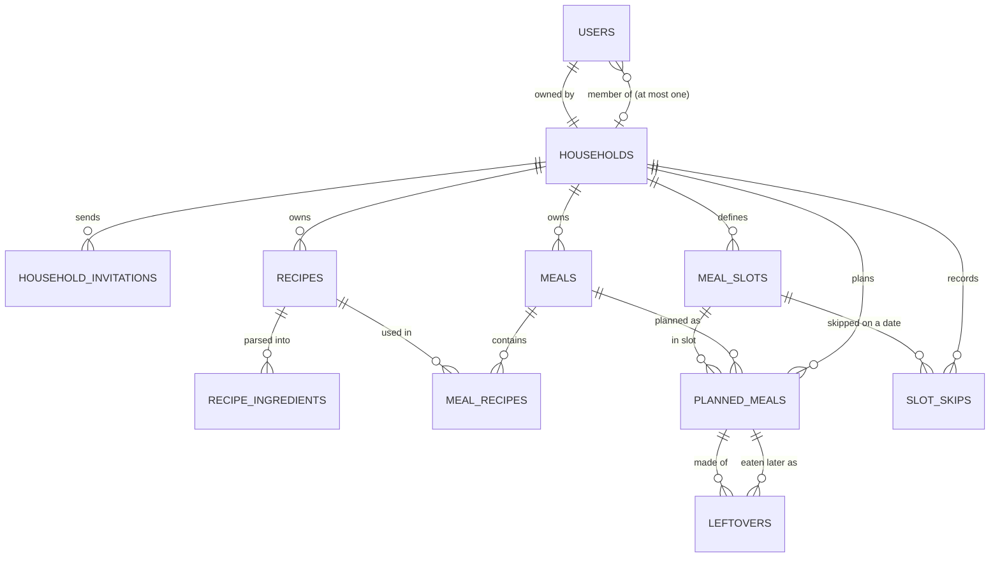
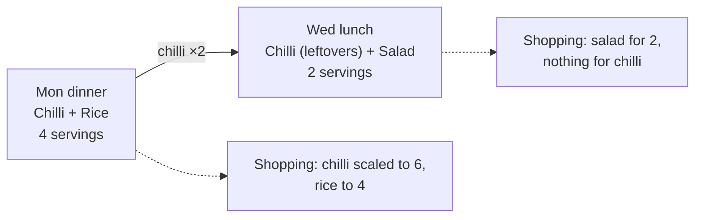
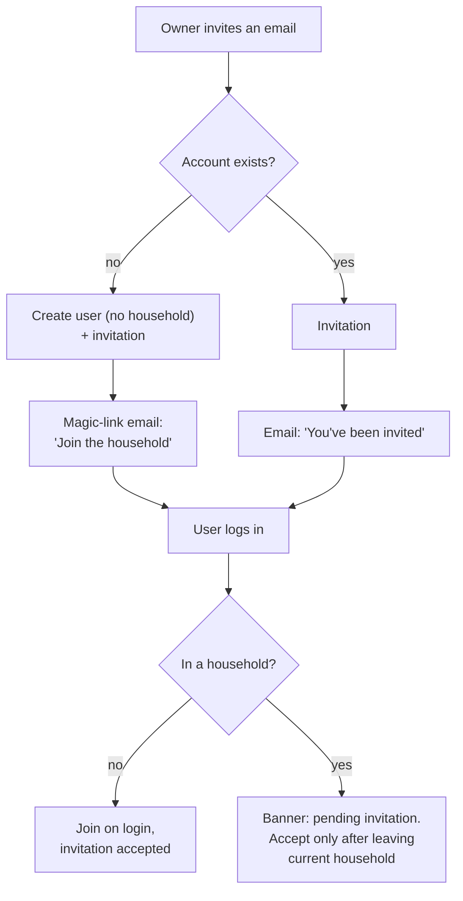

# Iteration 1 design: households and planning

Agreed 20 October 2026. Covers the stories in [USER_STORIES.md](../../USER_STORIES.md).
The shopping list is designed at the data-model level so iteration 1 doesn't
block it, but it's built in iteration 4. (It was iteration 2 until import and export,
then meal slot tags, were put first: see [iteration 2](iteration-2.md) and
[iteration 3](iteration-3.md).)

## Scope

| Iteration 1 | Iteration 4 | Later |
|---|---|---|
| Create a household, invite and remove members, leave, transfer ownership, delete | Shopping list for a date range from planned meals | Recipe import from a URL |
| Recipes in Cooklang with live preview; archive and restore | Scale to cooked servings; merge matching ingredients; convert within g/kg and ml/l | Photos, nutrition, pantry stock |
| Meals as named groups of recipes | Household staples left off; manual items; live ticking while shopping | Meal suggestions from history |
| Meal slots per household, owner-managed | Regenerates when the plan changes, keeping ticks and manual items | Notifications |
| Week planning on the phone: plan, skip, servings, leftovers, copy last week | | |

## Data model

Every table except `users` carries `household_id`, and every context function
takes the caller's `Scope`, which gains the user's household. Queries filter by
`scope.household.id`. Foreign keys between household tables are composite
(`household_id` plus id), so a cross-household reference is impossible at the
database level, not just in code.



Iteration 4 adds `shopping_lists`, `shopping_list_items` and `staples` on the
same keys.

### households (new)

| Field | Notes |
|---|---|
| `name` | Required; renamable by the owner |
| `owner_id` | → users. Exactly one owner; transfer changes it |
| `time_zone` | IANA name, e.g. `Europe/London`. Defines "today" and the current week. Set from the browser at creation, editable by the owner |
| `usually_feeding` | Positive integer, asked for at creation, editable by the owner. Default servings for newly planned meals |

### users (changed)

| Field | Notes |
|---|---|
| `household_id` | Nullable → households. One household per user, so a column rather than a membership table. Null means "show the create-household prompt" |
| `admin` | Unchanged: operator role (error dashboard, bootstrap invites), separate from household ownership |

### household_invitations (new)

| Field | Notes |
|---|---|
| `email` | citext, normalised |
| `invited_by_id` | → users (the owner) |
| `expires_at` | Sent + 7 days |
| `accepted_at`, `revoked_at` | Pending = both null and not expired. One pending invitation per household and email (partial unique index) |

### meal_slots (new)

| Field | Notes |
|---|---|
| `name` | Unique per household among active slots, case-insensitive |
| `position` | Order within the day |
| `default_key` | `breakfast`, `lunch`, `dinner`, `snack` or null; lets "restore defaults" re-create missing defaults without touching custom slots |
| `archived_at` | Set on delete when past plans use the slot, so history keeps its name |

### recipes (new)

| Field | Notes |
|---|---|
| `name` | Required |
| `servings` | Positive integer; the base for scaling |
| `source` | Cooklang text, the source of truth. May be empty |
| `created_by_id` | → users, for display only |
| `archived_at` | The archive rule |

### recipe_ingredients (new)

Derived from `source` on save, stored as rows so the iteration 4 shopping list
can aggregate in SQL.

| Field | Notes |
|---|---|
| `name`, `key` | As written, plus a normalised key (lower-case, trimmed, singular) for merging |
| `quantity`, `quantity_text` | Decimal; or the text as written ("few") in `quantity_text`; both null for "some" |
| `unit` | As written, plus canonical unit and dimension (mass, volume, count) for conversion |
| `scalable` | False for quantities that shouldn't scale |
| `optional`, `note` | `@?` ingredients, and `(note)` after the braces |

The steps aren't stored: pages parse `source` when they render it, which
takes milliseconds, so there is no derived copy to keep in step.

### meals and meal_recipes (new)

| Field | Notes |
|---|---|
| `meals.name` | Required; unique per household among active meals, ignoring case. A meal may have no recipes ("Eat out") |
| `meals.archived_at` | The archive rule |
| `meal_recipes` | `meal_id`, `recipe_id`, `position`, `removed_on`. A recipe is in a meal once at a time. Taking it out of a meal that past plans used sets `removed_on` (household-local date) instead of deleting the row, so those planned meals still resolve to their recipes, archived ones included. Composite keys with `household_id` keep both in one household |

Planning a recipe directly creates a one-recipe meal named after the recipe, or
reuses it if it exists.

### planned_meals (new)

| Field | Notes |
|---|---|
| `date` | Household-local date |
| `meal_slot_id` | → meal_slots |
| `meal_id` | → meals; restrict on delete (the archive rule handles it) |
| `servings` | People eating this meal; defaults to the household's `usually_feeding` |
| `position` | Order when a slot holds more than one meal |

### leftovers (new)

One row per leftover recipe; "the whole meal is leftovers" is a row for each of
its recipes.

| Field | Notes |
|---|---|
| `planned_meal_id` | The later meal that eats leftovers |
| `recipe_id` | Which recipe in it is leftovers |
| `source_planned_meal_id` | The earlier planned meal that is cooked bigger. Must be earlier (date, then slot position), at most 14 days before, and contain the same recipe; it may be in an earlier week |

### slot_skips (new)

| Field | Notes |
|---|---|
| `date`, `meal_slot_id` | Unique per household. A skipped slot counts as planned |

## Rules

### Cooked servings and leftovers

For each recipe in a planned meal that isn't itself leftovers:

```text
cooked = planned servings + Σ servings of later meals eating it as leftovers
scale  = cooked ÷ recipe servings
```

The shopping list multiplies each scalable ingredient by `scale`. Leftover
recipes add nothing; their servings are counted in the source. Examples, for a
chilli recipe that serves 4:

| Monday dinner | Wednesday lunch (leftovers) | Cooked Monday | Scale |
|---|---|---|---|
| 4 | 2 | 6 | ×1.5 |
| 2 | 2 | 4 | ×1 |

Leftovers come from a meal that cooks the recipe fresh, up to 14 days before
(long enough for something frozen at the weekend to feed the following week),
and one cooked meal can feed several later ones. A recipe eaten as leftovers
can't be the source of further leftovers. Moving or changing either meal
removes leftover links that no longer hold (earlier, within 14 days, both
meals contain the recipe); removing either meal removes them too. The extra
servings are cooked, and shopped for, in the source's week.

A leftover can cover one recipe of a meal while the rest is fresh:



### The planning week

- Weeks run Monday to Sunday in the household's time zone.
- A week is fully planned when every active slot on every day has at least one
  planned meal or a skip.
- The planner opens on the current week, or on next week once the current one
  is fully planned.
- "Copy last week" copies each day-and-slot (meals in order with their
  servings, or the skip) only where this week's slot is empty, so it never
  overwrites and repeating it changes nothing. A copied leftover link points
  at the copy of its source or, if that slot was already planned this week,
  at the meal there cooking the recipe fresh (the same meal preferred);
  failing both, as for leftovers from before the copied week, the meal is
  cooked fresh. Inactive slots and archived meals are left out.

### The archive rule

Deleting a recipe, meal or slot that appears in a plan dated before today
archives it instead (`archived_at`). Archived items disappear from lists and
pickers but still show in past weeks, and can be restored. Planned meals dated
today or later that use a deleted meal are removed, after a confirmation that
lists them. Anything never planned is deleted outright.

In detail:

- **Recipe:** taken out of every meal (rows past plans relied on keep
  `removed_on`), and leftover links for it from today on go; archived if a
  past plan used it, else deleted.
- **Meal:** planned meals from today on are removed; archived if planned
  before today, else deleted. Restoring is refused while another meal has its
  name.
- **Slot:** meals planned in it from today on must first be moved to another
  slot or removed, and its skips from today on go; archived if a past plan
  used it, else deleted. Past weeks show an archived slot, marked removed, on
  the days it holds meals.

## Invitations



Login rate limits and magic-link tokens are reused from iteration 0; an
invitation records intent and never logs anyone in by itself. Revoked or
expired invitations are ignored. Nobody is moved between households without
accepting.

## Screens

Phone first. A bottom tab bar: **Plan**, **Recipes**, **Meals**, **Household**
(iteration 4 adds **Shopping**). On wider screens it becomes a sidebar and the
week shows as a 7-column grid. The wireframes are in the design page that was
reviewed; their content:

- **Onboarding** (`/welcome`): pending invitations first (Join / Decline, with
  expiry), then "create your own": household name, usually feeding (stepper),
  optional emails to invite. The four default slots are added automatically.
- **Week plan** (`/plan`): week switcher, "23 of 28 slots planned" progress
  bar, "Copy last week". One card per day; slots in household order. Planned
  meals show as chips with servings; leftovers are marked ↺. Unplanned slots
  show "+ Add" and "Skip". Tap a meal to edit, move or remove it.
- **Add to a slot** (bottom sheet): "New meal" searches meals and recipes;
  "Leftovers" lists recipes planned in the previous 14 days (a meal repeated
  on several days once, as the latest), showing what the source meal will be
  cooked for. Servings stepper starting at the household's
  usual number.
- **Recipe list** (`/recipes`): search by name or ingredient; serving size and
  ingredient count per row; link to archived recipes.
- **Recipe editor**: name, serves, Write / Preview tabs. Cooklang in a text
  area with the parsed ingredients updating as you type (debounced). Parse
  problems show inline and never block saving.
- **Meal editor** (`/meals/:id`): add, remove and reorder recipes; "planned N
  times, last on …"; the delete button says in advance whether it will archive.
- **Household** (`/household`): owner manages members, pending invitations
  (revoke), usually feeding, time zone, and slots (rename, drag to reorder,
  delete, restore defaults); transfer ownership and delete at the bottom.
  Members see it read-only with "Leave household".

## Architecture

| Context | Owns | Notes |
|---|---|---|
| `Households` | households, invitations, membership, ownership, slots | Owner-only operations check `scope.household.owner_id`; creating a household seeds the default slots |
| `Recipes` | recipes, recipe_ingredients, archive/restore | Calls `Mealplan.Cooklang` on save |
| `Cooklang` | parser only, no database | Hand-written (ADR 13); pure functions from source to steps, ingredients, cookware, timers, metadata and warnings |
| `Meals` | meals, meal_recipes, archive/restore | |
| `Planning` | planned_meals, leftovers, slot_skips, week status | Owns the servings maths, which the shopping list reuses |

| Route | LiveView | Access |
|---|---|---|
| `/welcome` | `HouseholdLive.Onboarding` | authenticated, no household required |
| `/plan`, `/plan/:week` | `PlanLive.Week` | authenticated + `:require_household` on_mount (redirects to `/welcome`) |
| `/recipes`, `/recipes/new`, `/recipes/:id`, `/recipes/:id/edit` | `RecipeLive.*` | as above |
| `/meals`, `/meals/:id` | `MealLive.*` | as above |
| `/household` | `HouseholdLive.Settings` | as above |
| `/` | redirects to `/plan` | |

**Live updates:** each context broadcasts on a per-household PubSub topic
(`household:<id>`). Open week plans, recipe lists and the household page update
for every member without reloading; iteration 4's shared shopping list relies
on the same mechanism. Removing a member or deleting the household disconnects
that user's LiveViews.

## Decisions

All confirmed on 20 October 2026.

1. **One household per user, as a column on `users`.** Simpler than a
   membership table; several households per user later would need a migration
   to a join table.
2. **Leftovers per recipe, not per meal.** "The chilli is leftovers, the salad
   is fresh" works; the sheet makes "everything is leftovers" one tap.
3. **Default servings come from the household's "usually feeding" number**,
   asked for at creation and editable by the owner; each planned meal can be
   adjusted.
4. **Households have a time zone** for "today" and the current week, set from
   the browser at creation and editable by the owner.
5. **Write our own Cooklang parser**, tested against
   Cooklang's official spec tests. Hex had no maintained pure-Elixir parser
   ([ADR 13](../adr/0013-own-cooklang-parser.md)).
6. **Store parsed ingredients as rows**, so the shopping list merges and scales
   in SQL.
7. **The archive cutoff is "before today".** Plans dated today or later are
   changeable and are removed when their meal is deleted.
8. **Invitations go by email even to existing accounts**, with an in-app
   banner; nobody changes household without accepting.

## Changes made while building

The sections above are updated in place; this lists what differs from the
design as reviewed, for anyone comparing.

- **Invitation links** for new accounts last the invitation's 7 days, not 15
  minutes (still single use); existing accounts keep the short link.
- **The Cooklang parser** is hand-written rather than NimbleParsec (ADR 13,
  amended).
- **No `recipes.parsed` column:** pages parse the source when they render it.
- **Meal names are unique** per household among active meals, and planning a
  recipe directly names a new meal "Name (2)" if the recipe's name is taken.
- **Leftovers** may come from up to 14 days before, across weeks, so weekend
  batch cooking or freezing feeds the next week. There are no leftovers of
  leftovers, and moving or changing a meal drops links that no longer hold
  (with a confirmation). The Leftovers tab lists a repeated meal once.
- **Copying last week** never overwrites; copied leftover links point at the
  copy of their source or this week's matching meal, else the meal is cooked
  fresh.
- **Meal history:** `meal_recipes.removed_on` keeps what past planned meals
  contained after recipes are taken out of meals or archived.
- **Deleting a slot** with upcoming meals asks whether to move or remove them;
  archived slots still show in past weeks.
